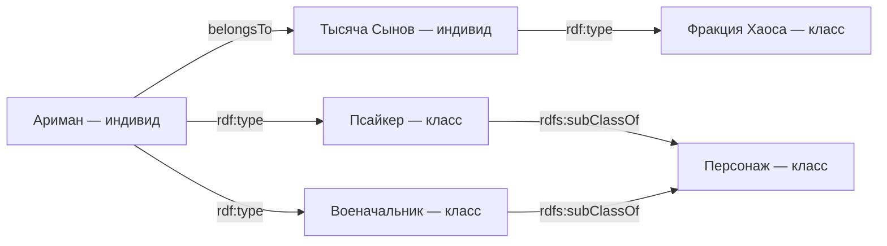

# Warhammer 40,000: теория и шпаргалка к лабораторной №1

Конспект относится к текущим файлам: knowledge_base.pl, queries.pl, tests.pl и ontology.owl. Все примеры ниже используют персонажей и фракции **Warhammer 40K**.

В VS Code: **Ctrl+Shift+V** открывает удобный предпросмотр Markdown.

## Шесть вопросов к защите: объяснение и демонстрация

Этот раздел показывает семантическую сеть, онтологию, OntoGraf, RDF-триплеты и базу знаний на примерах **Warhammer 40K**.

### 1. Семантическая сеть

**Семантическая сеть — представление знаний в виде графа:** узлы обозначают сущности или понятия, а подписанные связи — отношения между ними.



Три разных отношения:

- **belongsTo:** Ариман связан с фракцией Тысяча Сынов.
- **rdf:type:** Ариман является экземпляром класса Псайкер.
- **rdfs:subClassOf:** Псайкер является подклассом Персонажа.

Индивид Ариман — не подкласс фракции. Различие между экземпляром и подклассом нужно проговаривать при показе стрелок.

Семантические сети могут быть как поясняющими схемами, так и формальными системами с правилами вывода. Неверно утверждать, что у них принципиально не бывает строгой семантики. [Определение и разновидности семантических сетей](https://www.jfsowa.com/pubs/semnet.htm).

**Показать:** схему выше и узел Аримана со связями в OntoGraf.

### 2. Онтология и её состав

**Онтология — формальная модель понятий предметной области, отношений между ними и ограничений.** В нашей OWL-онтологии также есть конкретные объекты и утверждения о них.

| Компонент | Пример |
| --- | --- |
| Классы | `Character`, `Faction`, `Psyker`, `Commander` |
| Иерархия | `Psyker` — подкласс `Character` |
| Индивиды | `ahriman`, `thousand_sons` |
| Объектные свойства | `belongsTo`, `hostileFaction`, `enemyOf`, `allyOf` |
| Свойства данных | `threatRating` — числовой атрибут персонажа |
| Аксиомы и ограничения | Character и Faction несовместимы; у персонажа ровно одна основная фракция; рейтинг 0..10 |
| Правила SWRL | Разные персонажи Хаоса → союзники учебного сценария |
| Аннотации | `rdfs:label` «Ариман» и комментарии |

В формальном смысле объявления, утверждения, иерархия и ограничения задаются аксиомами. Таблица группирует их по назначению. SWRL — расширение модели, а не обязательный компонент любой OWL-онтологии.

Определение класса:

```text
ChaosCharacter EquivalentTo
    Character and belongsTo some ChaosFaction
```

Из фактов «Ариман — персонаж», «Ариман belongsTo Тысяча Сынов», «Тысяча Сынов — фракция Хаоса» reasoner выводит «Ариман — ChaosCharacter».

Один графический вид не показывает все ограничения. Например, кардинальность «ровно одна фракция» лучше демонстрировать в описании класса. Формальные конструкции: [OWL 2 Primer](https://www.w3.org/TR/owl2-primer/).

**Где показать в Protégé:**

1. **Entities → Classes:** Character, Faction, Psyker и иерархию.
2. **Entities → Object properties:** belongsTo, Domain = Character, Range = Faction.
3. **Entities → Data properties:** threatRating.
4. **Individuals by class:** Аримана, его типы и значения свойств.
5. У Character — ограничения числа значений; у ChaosCharacter — Equivalent To.
6. После **Reasoner → HermiT → Start reasoner** в DL Query выполнить `ChaosCharacter`: ожидаются Абаддон и Ариман.

### 3. Онтограф и OntoGraf

В этой лабораторной **онтограф — графическое представление онтологии**. **OntoGraf** — название плагина Protégé, которым этот граф можно показать.

Онтология хранится в `ontology.owl`. OntoGraf визуализирует выбранные классы, индивиды и отношения. Масштаб, раскладка и фильтры меняют рисунок, а не логические знания.

Плагин не заменяет reasoner и не обязан показывать все аксиомы одной картинкой. [Назначение OntoGraf](https://protegewiki.stanford.edu/wiki/OntoGraf).

**Как показать:**

1. Открыть `ontology.owl`.
2. Если вкладки нет — **Window → Tabs → OntoGraf**.
3. Перейти в OntoGraf и в Search ввести **Ариман** при русских labels.
4. Нажать Search и рассмотреть связи с Псайкером, Военачальником, Персонажем и Тысячей Сынов.
5. Настроить масштаб и раскладку для читаемого вида.

### 4. Разница между тремя понятиями

| Понятие | Что означает | В нашей лабораторной |
| --- | --- | --- |
| Семантическая сеть | Графовый способ представления знаний | Узлы Ариман, Псайкер, Тысяча Сынов и подписанные связи |
| Онтология | Формальная модель классов, свойств, объектов и ограничений | Логическое содержание ontology.owl |
| Онтограф | Графическое представление онтологии | Видимый фрагмент узлов и отношений |
| OntoGraf | Конкретный инструмент визуализации | Плагин и вкладка Protégé |

Это не взаимоисключающие виды данных: онтологию можно отобразить графом, имеющим общие черты с семантической сетью.

**Фраза для защиты:** «Семантическая сеть задаёт графовый способ представления знаний, OWL-онтология формализует модель и ограничения, а OntoGraf показывает её графом».

### 5. RDF-триплеты: из чего состоят и как показать

**RDF-триплет — утверждение из трёх частей: субъект, предикат, объект.**

```text
(субъект, предикат, объект)
(Ариман, belongsTo, Тысяча Сынов)
```

- **Субъект:** о ком или о чём говорим; начало стрелки.
- **Предикат:** какое отношение или свойство задано; подпись стрелки.
- **Объект:** с чем связан субъект или какое значение он имеет; конец стрелки.

В RDF 1.1 субъект — IRI или пустой узел; предикат — IRI; объект — IRI, пустой узел или литерал. [Формальный состав RDF-тройки](https://www.w3.org/TR/rdf11-concepts/#section-triples).

Эти восемь троек проверены непосредственно в текущем `ontology.owl`:

| Субъект | Предикат | Объект | Смысл |
| --- | --- | --- | --- |
| `:ahriman` | `rdf:type` | `:Character` | Ариман — персонаж |
| `:ahriman` | `rdf:type` | `:Psyker` | Ариман — псайкер |
| `:ahriman` | `rdf:type` | `:Commander` | Ариман — военачальник модели |
| `:ahriman` | `:belongsTo` | `:thousand_sons` | Связан с Тысячей Сынов |
| `:thousand_sons` | `rdf:type` | `:ChaosFaction` | Тысяча Сынов — фракция Хаоса |
| `:Psyker` | `rdfs:subClassOf` | `:Character` | Псайкер — подкласс Персонажа |
| `:belongsTo` | `rdf:type` | `owl:ObjectProperty` | belongsTo — объектное свойство |
| `:ahriman` | `:threatRating` | `"8"^^xsd:integer` | Учебный рейтинг — целое 8 |

Краткая запись того же фрагмента в Turtle:

```turtle
@prefix : <https://example.org/itmo/wh40k#> .
@prefix rdf: <http://www.w3.org/1999/02/22-rdf-syntax-ns#> .
@prefix rdfs: <http://www.w3.org/2000/01/rdf-schema#> .
@prefix owl: <http://www.w3.org/2002/07/owl#> .
@prefix xsd: <http://www.w3.org/2001/XMLSchema#> .

:ahriman rdf:type :Character .
:ahriman rdf:type :Psyker .
:ahriman rdf:type :Commander .
:ahriman :belongsTo :thousand_sons .
:thousand_sons rdf:type :ChaosFaction .
:Psyker rdfs:subClassOf :Character .
:belongsTo rdf:type owl:ObjectProperty .
:ahriman :threatRating "8"^^xsd:integer .
```

`:ahriman` сокращает IRI `https://example.org/itmo/wh40k#ahriman`. `"8"^^xsd:integer` — литерал с текстовой формой 8 и типом целого числа. Рейтинг — условный учебный атрибут.

Turtle и RDF/XML — разные способы записи RDF-графа. Сам `ontology.owl` использует RDF/XML.

**Триплет не равен Prolog-предикату с тремя аргументами.** Факт:

```prolog
belongs_to(ahriman, thousand_sons).
```

имеет два аргумента. В RDF имя отношения становится средней частью тройки `(ahriman, belongsTo, thousand_sons)`.

Одноаргументный факт:

```prolog
psyker(ahriman).
```

превращается в тройку типизации `(ahriman, rdf:type, Psyker)`.

Текущий RDF-граф содержит **381 тройку**. Это больше 40 исходных Prolog-фактов, поскольку RDF кодирует также объявления классов, ограничения, списки, SWRL, подписи и вспомогательные структуры.

**SPARQL-запрос для показа фактов об Аримане:**

```sparql
PREFIX : <https://example.org/itmo/wh40k#>
PREFIX rdf: <http://www.w3.org/1999/02/22-rdf-syntax-ns#>

SELECT ?predicate ?object WHERE {
  :ahriman ?predicate ?object .
  FILTER (?predicate IN (rdf:type, :belongsTo, :threatRating))
}
ORDER BY ?predicate ?object
```

Субъект зафиксирован как Ариман; два столбца результата показывают предикат и объект. Среди типов также присутствует `owl:NamedIndividual`.

В Protégé можно включить **Window → Tabs → SPARQL Query** и выполнить этот запрос. Он читает исходные утверждения, поэтому для него не требуется вывод SWRL.

### 6. База знаний

**База знаний — организованный набор фактов и правил/аксиом, позволяющий отвечать на вопросы предметной области.**

В нашей работе:

- `knowledge_base.pl` содержит Prolog-факты и семь правил.
- `ontology.owl` содержит OWL-аксиомы, утверждения об объектах и SWRL.
- `queries.pl` задаёт примеры вопросов.
- Интерпретатор или reasoner выполняет логический вывод.

**Показать исходные факты:**

```prolog
character(ahriman).
belongs_to(ahriman, thousand_sons).
chaos_faction(thousand_sons).
```

**Показать правило:**

```prolog
chaos_character(Character) :-
    character(Character),
    belongs_to(Character, Faction),
    chaos_faction(Faction).
```

**Показать результат:**

```prolog
?- chaos_character(ahriman).
true.

?- setof(C, chaos_character(C), L).
L = [abaddon, ahriman].
```

Исходного Prolog-факта `chaos_character(ahriman).` нет: ответ получается применением правила.

При обсуждении OWL часто выделяют:

- **TBox:** терминологические аксиомы, например «Псайкер — подкласс Персонажа».
- **ABox:** утверждения об индивидах, например «Ариман — Псайкер» и «Ариман belongsTo Тысяча Сынов».
- **RBox:** аксиомы свойств, когда их рассматривают отдельно, например симметричность hostileFaction.

Схема и утверждения об объектах могут находиться в одной OWL-онтологии. Утверждение «онтология всегда содержит только классы, без конкретных фактов» неверно.

### Последовательность показа преподавателю

1. В VS Code показать факты об Аримане и правило chaos_character/1.
2. В SWI-Prolog выполнить `chaos_character(ahriman).` и запрос на список персонажей Хаоса.
3. В Protégé показать классы, свойства и индивида Аримана.
4. В OntoGraf найти Аримана и объяснить узлы и стрелки.
5. В SPARQL Query показать таблицу троек и объяснить субъект, предикат, объект.
6. После HermiT показать выводимый тип ChaosCharacter.

**Короткий ответ:** «Семантическая сеть показывает знания узлами и связями. Онтология задаёт формальную модель с классами, свойствами, индивидами и ограничениями. OntoGraf визуализирует её. RDF-триплет состоит из субъекта, предиката и объекта. База знаний хранит исходные сведения и условия вывода, по которым Prolog или reasoner отвечает на запросы».

---

## Содержание

1. [Что делает лабораторная](#1-что-делает-лабораторная)
2. [Данные и ограничения модели](#2-данные-и-ограничения-модели)
3. [Запуск и ввод запросов](#3-запуск-и-ввод-запросов)
4. [Факты, термы, переменные и предикаты](#4-факты-термы-переменные-и-предикаты)
5. [Правила, унификация и поиск с возвратом](#5-правила-унификация-и-поиск-с-возвратом)
6. [И, или, не и скобки](#6-и-или-не-и-скобки)
7. [Равенство, различие и арифметика](#7-равенство-различие-и-арифметика)
8. [Собираем ответы: setof, findall, bagof](#8-собираем-ответы-setof-findall-bagof)
9. [Пересечение, объединение, разность и дополнение](#9-пересечение-объединение-разность-и-дополнение)
10. [Операции над списками-множествами](#10-операции-над-списками-множествами)
11. [Подробный разбор семи правил](#11-подробный-разбор-семи-правил)
12. [Служебный синтаксис и вывод результатов](#12-служебный-синтаксис-и-вывод-результатов)
13. [Тесты и проверка объёма базы](#13-тесты-и-проверка-объёма-базы)
14. [Отладка, рекурсия и отсечение](#14-отладка-рекурсия-и-отсечение)
15. [Онтология OWL: классы, свойства и ограничения](#15-онтология-owl-классы-свойства-и-ограничения)
16. [Protégé, SWRL и SPARQL](#16-protégé-swrl-и-sparql)
17. [Готовые запросы и ответы](#17-готовые-запросы-и-ответы)
18. [Ошибки и ответы для защиты](#18-ошибки-и-ответы-для-защиты)

## 1. Что делает лабораторная

Суть — **задать знания о предметной области и получать из них новые выводы по правилам**.

Например:

> Ариман связан с фракцией Тысяча Сынов. Эта фракция относится к Хаосу. Значит, Ариман — персонаж Хаоса. Он также псайкер и военачальник, поэтому входит в пересечение этих двух групп.

В первой части знания записаны на Prolog. Во второй они представлены в OWL для Protégé. В документе курса это две части лабораторной №1; в PDF-методичке они разделены на отдельные работы.

| Файл | Для чего нужен |
| --- | --- |
| knowledge_base.pl | 25 фактов с одним аргументом, 15 с двумя и 7 правил предметной области |
| queries.pl | 10 демонстрационных запросов с фактической печатью результатов |
| tests.pl | 29 автоматических тестов |
| ontology.owl | Классы, индивиды, свойства, ограничения и SWRL |
| theory.md | Этот конспект |

**Роли программ:** VS Code редактирует текст; SWI-Prolog выполняет запросы; Protégé показывает классы, объекты и отношения; reasoner проверяет логическую согласованность и выводит следствия.

## 2. Данные и ограничения модели

В базе шесть персонажей и шесть фракций.

| Атом персонажа | Имя | Атом фракции | Категория |
| --- | --- | --- | --- |
| roboute_guilliman | Робаут Жиллиман | ultramarines | Империум |
| mephiston | Мефистон | blood_angels | Империум |
| abaddon | Абаддон | black_legion | Хаос |
| ahriman | Ариман | thousand_sons | Хаос |
| eldrad_ulthran | Эльдрад Ультран | aeldari | Ксеносы |
| imotekh | Имотех | necrons | Ксеносы |

Категория «ксеносы» объединяет чуждые человечеству фракции по типу, но **не означает общий союз**.

Для примеров пересечений заданы:

- Псайкеры: Мефистон, Ариман и Эльдрад.
- Военачальники модели: Жиллиман, Абаддон, Ариман и Имотех.
- Ариман входит в обе группы.

Военачальники здесь — выбранная учебная группа. Отсутствие Мефистона в commander/1 не означает, что он никогда никем не командует в лоре.

### Учебные допущения

Официальные имена, принадлежность и известные роли сверены с материалами Warhammer. Дополнительные правила сценария заданы для изучения логики:

1. **threat_rating/2** — придуманный учебный рейтинг от 0 до 10. Он не является очками модели, характеристикой настолки или канонической оценкой силы.
2. **dangerous/1** классифицирует персонажей по этому рейтингу и признакам.
3. **hostile_faction/2** содержит три выбранных конфликта. Отсутствие конфликта в базе не означает канонический мир.
4. **allies/2** допускает сотрудничество двух разных персонажей Империума либо двух персонажей Хаоса. Это упрощение сценария, а не правила составления армии.
5. Список псайкеров считается полным **для шести известных персонажей**.

| Персонаж | Псайкер в базе | Военачальник в базе | Учебный рейтинг |
| --- | --- | --- | --- |
| roboute_guilliman | Нет | Да | 10 |
| mephiston | Да | Не отмечен | 7 |
| abaddon | Нет | Да | 9 |
| ahriman | Да | Да | 8 |
| eldrad_ulthran | Да | Не отмечен | 9 |
| imotekh | Нет | Да | 8 |

### Откуда берутся требуемые количества фактов

| Предикаты | Число фактов |
| --- | --- |
| faction/1 | 6 |
| character/1 | 6 |
| psyker/1 | 3 |
| commander/1 | 4 |
| imperial_faction/1, chaos_faction/1, xenos_faction/1 | 2 + 2 + 2 |
| **Всего одноаргументных** | **25** |
| belongs_to/2 | 6 |
| threat_rating/2 | 6 |
| hostile_faction/2 | 3 |
| **Всего двухаргументных** | **15** |

Выводимые свойства вроде imperial_character/1 задаются правилами и не включаются в число исходных фактов. Служебные правила печати и тестирования находятся в отдельных файлах и не включаются в семь правил предметной области.

## 3. Запуск и ввод запросов

В терминале VS Code:

```powershell
cd D:\ITMO\ITMOlabs\systems-of-artificial-intelligence\lab1
swipl -s knowledge_base.pl
```

SWI-Prolog установлен в постоянную папку пользователя и добавлен в пользовательский PATH. Если терминал был открыт до установки, обнови PATH в этой сессии:

```powershell
$env:Path += ";$env:LOCALAPPDATA\Programs\SWI-Prolog\bin"
swipl -s knowledge_base.pl
```

Можно запустить интерпретатор и по полному пути, независимо от PATH:

```powershell
& "$env:LOCALAPPDATA\Programs\SWI-Prolog\bin\swipl.exe" -s knowledge_base.pl
```

После полного перезапуска VS Code новые терминалы получат обновлённый пользовательский PATH. На другом компьютере SWI-Prolog можно установить с [официальной страницы](https://www.swi-prolog.org/download/stable).

После запуска появится приглашение:

```text
?-
```

Примеры в конспекте содержат это приглашение, чтобы отделить запрос от ответа. **Вводить повторно символы ?- не нужно.**

```prolog
?- character(ahriman).
true.

?- character(unknown_character).
false.

?- psyker(C).
C = mephiston ;
C = ahriman ;
C = eldrad_ulthran.
```

После ответа нажми **;**, чтобы получить следующий вариант, или **Enter**, чтобы закончить просмотр. Если запросить следующую альтернативу после последнего решения, интерпретатор может вывести false. Это означает, что дальнейших ответов нет.

Точка в конце завершает запрос. Перенос строки до точки позволяет продолжать ввод.

Если SWI-Prolog уже открыт:

```prolog
?- use_module(knowledge_base).
true.
```

Полезные команды:

```prolog
?- listing(dangerous/1).
```

Показывает исходное определение предиката.

```prolog
?- make.
```

Перезагружает изменённые файлы, уже загруженные интерпретатором.

```prolog
?- halt.
```

Завершает работу.

Демонстрация и тесты из терминала:

```powershell
swipl -q -s queries.pl -g main -t halt
swipl -q -s tests.pl -g run_tests -t halt
```

| Параметр | Смысл |
| --- | --- |
| -q | Убрать приветствие |
| -s FILE | Загрузить файл |
| -g GOAL | Выполнить указанную цель |
| -t halt | Завершить процесс после выполнения |

Команды PowerShell вводятся в терминале, а Prolog-запросы — внутри SWI-Prolog.

## 4. Факты, термы, переменные и предикаты

### 4.1. Факт

Факт — безусловное утверждение:

```prolog
character(ahriman).
psyker(ahriman).
belongs_to(ahriman, thousand_sons).
```

Читается: «Ариман — персонаж», «Ариман — псайкер», «Ариман связан с Тысячей Сынов».

### 4.2. Предикат и арность

Предикат описывает свойство или отношение. Арность — количество аргументов.

| Пример | Имя и арность | Значение |
| --- | --- | --- |
| character(ahriman) | character/1 | Свойство персонажа |
| belongs_to(ahriman, thousand_sons) | belongs_to/2 | Отношение персонажа и фракции |
| enemies(ahriman, mephiston) | enemies/2 | Отношение двух персонажей |

Запись psyker/1 — имя и число аргументов. Символ / здесь не означает арифметическое деление.

Предикаты с одинаковым именем, но разной арностью — разные предикаты. Все факты psyker(...) вместе составляют определение psyker/1.

### 4.3. Термы

Терм — базовая форма значения или структуры Prolog.

| Вид | Примеры |
| --- | --- |
| Атом | ahriman, chaos, thousand_sons |
| Число | 8, 10 |
| Переменная | Character, Faction, Rating, C |
| Составной терм | belongs_to(ahriman, thousand_sons) |
| Пара как составной терм | ahriman-thousand_sons |
| Список | [ahriman, mephiston] |
| Строка SWI-Prolog | "character(ahriman)." |

Атомы в базе начинаются со строчной буквы, переменные — с заглавной или символа подчёркивания.

```prolog
?- belongs_to(ahriman, Faction).
Faction = thousand_sons.
```

ahriman — конкретный атом. Faction — переменная, которая получает значение из найденного факта.

Атом с пробелами или заглавной буквой записывают в одинарных кавычках: 'Roboute Guilliman'. Атом 'ahriman' совпадает с ahriman. Строка "ahriman" при стандартных настройках современного SWI-Prolog — другой вид терма.

### 4.4. Одинаковое имя переменной связывает условия

```prolog
?- psyker(C), commander(C).
C = ahriman.
```

Обе цели относятся к одному значению C, поэтому ищется один персонаж с обоими свойствами.

```prolog
?- psyker(P), commander(C).
```

Здесь P и C — разные переменные. Перебираются пары псайкера и военачальника: три варианта P и четыре варианта C, всего двенадцать пар. Это декартово произведение.

Область переменной — одна клауза или один запрос. Переменная C в следующем запросе независима от C в предыдущем.

### 4.5. Анонимная переменная

```prolog
?- belongs_to(_, necrons).
true.
```

Вопрос: «Есть ли известный персонаж фракции некронов?» Его имя не нужно получать.

Каждое отдельное вхождение _ — новая независимая переменная. Именованная _Character ведёт себя как обычная переменная: повторение этого имени в одной клаузе связывает значения.

### 4.6. Списки

- [ahriman, mephiston] — список двух элементов.
- [] — пустой список.
- [Head|Tail] — первый элемент и остаток списка.
- Порядок элементов и повторы имеют значение.

Например:

```prolog
?- [Head|Tail] = [ahriman, mephiston, imotekh].
Head = ahriman,
Tail = [mephiston, imotekh].
```

Список сам по себе не является математическим множеством. Для представления множества можно договориться хранить отсортированный список без повторов.

### 4.7. Комментарии

```prolog
% Комментарий до конца строки.

/* Комментарий
   на несколько строк. */
```

Комментарии объясняют смысл модели, но не создают факты.

## 5. Правила, унификация и поиск с возвратом

### 5.1. Общий вид правила

```prolog
imperial_character(Character) :-
    character(Character),
    belongs_to(Character, Faction),
    imperial_faction(Faction).
```

Читается: «Персонаж относится к Империуму, **если** он известен базе и его фракция относится к Империуму».

| Часть | Смысл |
| --- | --- |
| imperial_character(Character) | Голова — какое заключение доказываем |
| :- | «Если» |
| Условия после :- | Тело — подцели для доказательства |
| . | Конец клаузы |

Правило задаёт достаточное условие вывода головы. Переменные связывают голову и тело.

В логической форме:

```text
character(C) ∧ belongs_to(C, F) ∧ imperial_faction(F)
    → imperial_character(C)
```

### 5.2. Унификация

Унификация — подбор значений переменных, позволяющий согласовать термы.

```prolog
?- belongs_to(ahriman, F) = belongs_to(ahriman, thousand_sons).
F = thousand_sons.
```

Имя структуры и арность совпали. Первые аргументы совпали, а F связывается с thousand_sons.

```prolog
?- belongs_to(ahriman, F) = belongs_to(abaddon, black_legion).
false.
```

Атомы ahriman и abaddon различаются, поэтому унификация невозможна.

Унификация используется и при сопоставлении запроса с фактом или головой правила.

### 5.3. Как идёт поиск

1. Выбирается очередная цель, обычно крайняя слева в теле.
2. Prolog ищет подходящий факт или голову правила в порядке исходных клауз.
3. Выполняется унификация.
4. Если выбрано правило, его тело становится новыми подцелями.
5. При неудаче выполняется возврат к доступной альтернативе.
6. Когда все цели доказаны, выдаются найденные значения.

Такой возврат называется backtracking. Связывания, сделанные на неудачной ветке, отменяются. Обычный поиск Prolog идёт в глубину, поэтому порядок целей влияет на завершение и эффективность.

Положительные правила имеют форму хорновских клауз. Логический шаг замены цели телом подходящего правила связан с резолюцией; для определённых клауз говорят о SLD-резолюции. Отрицание как неудача добавляет проверку неуспеха внутренней цели.

### 5.4. Пошаговый пример

```prolog
?- chaos_character(ahriman).
true.
```

Ход доказательства:

1. Цель сопоставляется с головой chaos_character(Character).
2. Character связывается с ahriman.
3. character(ahriman) находится среди фактов.
4. belongs_to(ahriman, Faction) связывает Faction с thousand_sons.
5. chaos_faction(thousand_sons) находится среди фактов.
6. Все условия успешны — запрос доказан.

Для chaos_character(mephiston) первые проверки выполняются, но chaos_faction(blood_angels) не доказывается. Вся ветка завершается неудачей.

## 6. И, или, не и скобки

### 6.1. Запятая — «И»

```prolog
?- psyker(C), commander(C).
C = ahriman.
```

Требуются оба условия для одного C. Это пересечение множеств персонажей.

### 6.2. Точка с запятой — «ИЛИ»

```prolog
?- (psyker(C); commander(C)).
```

Достаточно любого из двух условий. Это включающее «или»: персонаж может подходить по обеим веткам. Ариман получит два доказательства.

Символ ; внутри запроса — оператор. Нажатие ; после ответа — команда интерфейсу искать следующую альтернативу.

### 6.3. Отрицание как неудача

```prolog
?- \+ psyker(abaddon).
true.

?- \+ psyker(ahriman).
false.
```

Внутренняя цель psyker(abaddon) не доказана — отрицание успешно. Для Аримана факт существует — отрицание неуспешно.

Смысл `\+` Goal: «поиск доказательства Goal завершился неудачей». Это зависит от сведений базы. Для шести персонажей список псайкеров задан как полный.

### 6.4. Сначала перебор, затем отрицание

```prolog
?- setof(C, (character(C), \+ psyker(C)), L).
L = [abaddon, imotekh, roboute_guilliman].
```

character(C) сначала подставляет конкретного персонажа, затем проверяется отсутствие свойства.

Другая постановка:

```prolog
?- \+ psyker(C).
false.
```

Здесь C свободна. Внутренний запрос может найти хоть одного псайкера, поэтому отрицание сразу неуспешно. Перечисления не-псайкеров не происходит.

Успешное отрицание не передаёт наружу значения, найденные при внутренней проверке. Если внутренняя цель зациклилась, отрицание тоже не завершится; если она вызвала исключение, `\+` не превращает ошибку в успешный ответ.

### 6.5. Приоритет операторов

```text
A, B ; C
```

Группируется как:

```text
(A, B) ; C
```

Для смысла «A и при этом B или C» нужны скобки:

```text
A, (B ; C)
```

Поэтому dangerous/1 записано с явными скобками вокруг альтернатив ролей:

```prolog
dangerous(C) :-
    character(C), threat_rating(C, Rating), Rating >= 8,
    (psyker(C); commander(C)).
```

Описание управляющих операторов: [SWI-Prolog — Control Predicates](https://www.swi-prolog.org/pldoc/man?section=control).

## 7. Равенство, различие и арифметика

| Оператор | Назначение |
| --- | --- |
| `X = Y` | Унификация, возможное связывание переменных |
| `X == Y` | Проверка текущей идентичности без связывания |
| `X \== Y` | Проверка текущей неидентичности |
| `X \= Y` | Проверка невозможности унификации сейчас |
| `dif(X, Y)` | Условие различия термов, в том числе на будущее |
| X is Expr | Вычислить выражение справа и унифицировать результат с X |
| `A =:= B` | Арифметическое равенство значений |
| `A =\= B` | Арифметическое неравенство значений |
| `A >= B, A =< B, A > B, A < B` | Арифметические сравнения |

В Prolog «меньше или равно» пишется **=<**, а не <=.

### 7.1. Унификация и вычисление

```prolog
?- X = 2 + 3.
X = 2+3.

?- X is 2 + 3.
X = 5.

?- 2 + 3 =:= 5.
true.
```

Первый запрос связывает X со структурой +(2,3). Второй вычисляет сумму, третий сравнивает числовые значения.

### 7.2. Арифметике нужны числа

```prolog
?- threat_rating(ahriman, R), R >= 8.
R = 8.
```

Сначала R получает число. Если выполнить R >= 8 с неизвестной R, обычная арифметика выдаст ошибку недостаточно определённого аргумента. Она не перебирает подходящие значения сама.

Для ограничений на неизвестные целые числа существует библиотека clpfd с операторами вроде #>=. В текущей работе она не используется.

### 7.3. Различие персонажей

```prolog
?- dif(ahriman, abaddon).
true.

?- dif(ahriman, ahriman).
false.

?- dif(X, ahriman), X = abaddon.
X = abaddon.

?- dif(X, ahriman), X = ahriman.
false.
```

dif/2 сохраняет ограничение, пока значения неизвестны. Для сравнения, X `\=` ahriman при свободной X сразу неуспешно, потому что эти термы пока можно унифицировать.

X `\==` Y проверяет только нынешнюю неидентичность; оно не запрещает двум свободным переменным позднее получить одно значение.

В allies/2 и enemies/2 dif исключает отношения персонажа с самим собой.

Документация: [dif/2](https://www.swi-prolog.org/pldoc/doc_for?object=dif/2), [арифметика](https://www.swi-prolog.org/pldoc/man?section=arith).

## 8. Собираем ответы: setof, findall, bagof

### 8.1. setof/3

```text
setof(ШаблонОтвета, УсловиеПоиска, Список)
```

```prolog
?- setof(C, psyker(C), L).
L = [ahriman, eldrad_ulthran, mephiston].
```

C — что собираем; psyker(C) — где ищем; L — результат.

setof собирает различные решения, сортирует их по стандартному порядку термов и удаляет повторы. Для атомов нашей базы порядок выглядит как алфавитная сортировка имён.

### 8.2. findall/3

```prolog
?- findall(C, (psyker(C); commander(C)), L).
L = [mephiston, ahriman, eldrad_ulthran, roboute_guilliman, abaddon, ahriman, imotekh].
```

findall сохраняет порядок нахождения и повторы. Ариман появляется в каждой ветке.

```prolog
?- setof(C, (psyker(C); commander(C)), L).
L = [abaddon, ahriman, eldrad_ulthran, imotekh, mephiston, roboute_guilliman].
```

Это уже множество из шести персонажей.

### 8.3. Пустой результат

```prolog
?- setof(C, (imperial_character(C), chaos_character(C)), L).
false.

?- findall(C, (imperial_character(C), chaos_character(C)), L).
L = [].
```

В нашей модели персонаж не относится сразу к Империуму и Хаосу. setof завершается неудачей, findall успешно возвращает пустой список.

Универсальный вариант для списка-множества, включая пустой случай:

```prolog
?- findall(C, (imperial_character(C), chaos_character(C)), Raw), sort(Raw, L).
Raw = [],
L = [].
```

sort/2 сортирует и удаляет повторы.

### 8.4. Свободные переменные и группировка

```prolog
?- setof(C, belongs_to(C, Faction), L).
```

Faction участвует в цели, но не входит в шаблон C. Поэтому будут выдаваться отдельные списки персонажей для каждой фракции. Например:

```text
Faction = aeldari,
L = [eldrad_ulthran] ;
Faction = black_legion,
L = [abaddon] ;
... остальные фракции ...
```

Для общего множества персонажей без группировки:

```prolog
?- setof(C, Faction^belongs_to(C, Faction), L).
L = [abaddon, ahriman, eldrad_ulthran, imotekh, mephiston, roboute_guilliman].
```

Faction^ исключает переменную из группировки. При составном условии:

```prolog
?- setof(C, F^(belongs_to(C, F), chaos_faction(F)), L).
L = [abaddon, ahriman].
```

Для сохранения связи персонажа и фракции собираем пары:

```prolog
?- setof(C-F, belongs_to(C, F), L).
L = [abaddon-black_legion, ahriman-thousand_sons, eldrad_ulthran-aeldari, imotekh-necrons, mephiston-blood_angels, roboute_guilliman-ultramarines].
```

C-F — структура -(C,F), удобное обозначение пары. Вычитание не выполняется, пока терм не передан вычисляющему арифметическому оператору.

### 8.5. bagof и сравнение

bagof сохраняет повторные решения, но группирует по свободным переменным как setof.

| Свойство | findall/3 | bagof/3 | setof/3 |
| --- | --- | --- | --- |
| Повторы сохраняются | Да | Да | Нет |
| Сортировка | Нет | Нет | Да |
| Группировка по свободным переменным цели | Нет | Да | Да |
| При отсутствии решений | [] | Неудача | Неудача |

В findall переменные цели вне шаблона автоматически рассматриваются как существующие, без группировки.

Документация: [Finding all Solutions](https://www.swi-prolog.org/pldoc/man?section=allsolutions).

## 9. Пересечение, объединение, разность и дополнение

Зафиксируем множества:

```text
P = псайкеры = {ahriman, eldrad_ulthran, mephiston}
C = военачальники = {abaddon, ahriman, imotekh, roboute_guilliman}
U = все шесть известных персонажей
```

Эти множества отражают содержимое базы, включая выбранную учебную группу commander/1.

### 9.1. Пересечение P ∩ C

Кто одновременно псайкер и военачальник?

```prolog
?- setof(X, (psyker(X), commander(X)), L).
L = [ahriman].
```

**Общий шаблон:** setof(X, (a(X), b(X)), L).

Нужны запятая и одна общая переменная X.

### 9.2. Объединение P ∪ C

Кто псайкер или военачальник, включая обладающих обоими свойствами?

```prolog
?- setof(X, (psyker(X); commander(X)), L).
L = [abaddon, ahriman, eldrad_ulthran, imotekh, mephiston, roboute_guilliman].
```

**Общий шаблон:** setof(X, (a(X); b(X)), L).

Нужны ; и setof для удаления повторов.

### 9.3. Разность P \ C

Кто отмечен псайкером, но не отмечен военачальником?

```prolog
?- setof(X, (psyker(X), \+ commander(X)), L).
L = [eldrad_ulthran, mephiston].
```

**Общий шаблон:** setof(X, (a(X), `\+` b(X)), L).

Положительная цель сначала определяет кандидата, затем проверяется отрицание.

Обратная разность C \ P:

```prolog
?- setof(X, (commander(X), \+ psyker(X)), L).
L = [abaddon, imotekh, roboute_guilliman].
```

Разность некоммутативна: порядок множеств важен.

### 9.4. Дополнение U \ P

Кто из известных персонажей не является псайкером?

```prolog
?- setof(X, (character(X), \+ psyker(X)), L).
L = [abaddon, imotekh, roboute_guilliman].
```

Дополнение всегда задаётся относительно универсума. character(X) ограничивает его известными персонажами. Фракции и произвольные атомы в ответ не попадут.

### 9.5. Симметрическая разность P △ C

Нужно ровно одно свойство, а не оба:

```prolog
?- setof(X, ((psyker(X), \+ commander(X)); (commander(X), \+ psyker(X))), L).
L = [abaddon, eldrad_ulthran, imotekh, mephiston, roboute_guilliman].
```

Формула: (P \ C) ∪ (C \ P). Исключается Ариман.

### 9.6. Три условия одновременно

Кто псайкер, военачальник и персонаж Хаоса?

```prolog
?- setof(X, (psyker(X), commander(X), chaos_character(X)), L).
L = [ahriman].
```

Можно добавлять и числовой фильтр:

```prolog
?- setof(X, (psyker(X), threat_rating(X, R), R >= 8), L).
```

Здесь R — свободная переменная цели вне шаблона: setof будет группировать по рейтингу! Чтобы получить единое множество, исключаем её:

```prolog
?- setof(X, R^(psyker(X), threat_rating(X, R), R >= 8), L).
L = [ahriman, eldrad_ulthran].
```

Или используем готовое правило dangerous/1, если его более широкое условие «псайкер или военачальник» соответствует вопросу.

### 9.7. Количество и печать

```prolog
?- setof(X, (psyker(X), commander(X)), L), length(L, N).
L = [ahriman],
N = 1.
```

Для вывода списка:

```prolog
?- setof(X, (psyker(X), commander(X)), L), writeln(L).
% На экран будет напечатано [ahriman].
% Консоль также покажет связывание L.
```

Из терминала одним запуском:

```powershell
swipl -q -s knowledge_base.pl -g "setof(X, (psyker(X), commander(X)), L), writeln(L)" -t halt
```

Для пустого результата используй findall и sort, чтобы затем получить N = 0.

### 9.8. Подмножество и непересечение

«Все заданные военачальники проходят учебный критерий dangerous» означает отсутствие контрпримера:

```prolog
?- \+ (commander(X), \+ dangerous(X)).
true.
```

«Все псайкеры относятся к Хаосу»:

```prolog
?- \+ (psyker(X), \+ chaos_character(X)).
false.
```

Мефистон или Эльдрад дают контрпример.

«Множества Империума и Хаоса не пересекаются»:

```prolog
?- \+ (imperial_character(X), chaos_character(X)).
true.
```

Проверки требуют завершающегося поиска. При пустом первом множестве условие «все его элементы подходят» истинно по пустой области.

Успешный запрос на непересечение не добавляет ограничения на будущие факты. Это проверка текущей базы.

## 10. Операции над списками-множествами

Можно сначала собрать списки, а затем применить библиотечные операции.

```prolog
?- use_module(library(ordsets)).
true.
```

```prolog
?- setof(X, psyker(X), P), setof(X, commander(X), C), ord_intersection(P, C, Intersection), ord_union(P, C, Union), ord_subtract(P, C, Difference), ord_symdiff(P, C, SymmetricDifference).
P = [ahriman, eldrad_ulthran, mephiston],
C = [abaddon, ahriman, imotekh, roboute_guilliman],
Intersection = [ahriman],
Union = [abaddon, ahriman, eldrad_ulthran, imotekh, mephiston, roboute_guilliman],
Difference = [eldrad_ulthran, mephiston],
SymmetricDifference = [abaddon, eldrad_ulthran, imotekh, mephiston, roboute_guilliman].
```

Запрос можно переносить на несколько строк до завершающей точки.

| Предикат | Операция |
| --- | --- |
| ord_intersection(A, B, R) | Пересечение |
| ord_union(A, B, R) | Объединение |
| ord_subtract(A, B, R) | Разность A без B |
| ord_symdiff(A, B, R) | Симметрическая разность |
| ord_subset(A, B) | Проверка A ⊆ B |
| ord_disjoint(A, B) | Проверка непересечения |

Входные списки должны быть отсортированы и не содержать повторов. В нашей работе это списки конкретных атомов, полученные setof или sort.

```prolog
?- sort([mephiston, ahriman, ahriman], L).
L = [ahriman, mephiston].
```

Без предварительного вычисления списков чаще удобнее условия с запятой, точкой с запятой и отрицанием. Описание библиотеки: [library(ordsets)](https://www.swi-prolog.org/pldoc/man?section=ordsets).

## 11. Подробный разбор семи правил

### 11.1. imperial_character/1

```prolog
imperial_character(Character) :-
    character(Character), belongs_to(Character, Faction), imperial_faction(Faction).
```

Композиция принадлежности и категории фракции.

```prolog
?- setof(C, imperial_character(C), L).
L = [mephiston, roboute_guilliman].
```

Faction — внутренняя переменная правила. При вызове imperial_character(C) она не становится свободной переменной внешнего setof.

### 11.2. chaos_character/1

```prolog
chaos_character(Character) :-
    character(Character), belongs_to(Character, Faction), chaos_faction(Faction).
```

```prolog
?- setof(C, chaos_character(C), L).
L = [abaddon, ahriman].
```

### 11.3. xenos_character/1

```prolog
xenos_character(Character) :-
    character(Character), belongs_to(Character, Faction), xenos_faction(Faction).
```

```prolog
?- setof(C, xenos_character(C), L).
L = [eldrad_ulthran, imotekh].
```

Общая категория ксеносов не создаёт отношения allies.

### 11.4. dangerous/1

```prolog
dangerous(Character) :-
    character(Character), threat_rating(Character, Rating), Rating >= 8,
    (psyker(Character); commander(Character)).
```

Условия:

1. Персонаж присутствует в базе.
2. Его учебный рейтинг не меньше 8.
3. Он псайкер или один из заданных военачальников.

```prolog
?- setof(C, dangerous(C), L).
L = [abaddon, ahriman, eldrad_ulthran, imotekh, roboute_guilliman].
```

Мефистон не проходит придуманный порог рейтинга. Это результат выбранных учебных чисел, а не утверждение о его реальной силе в лоре.

У Аримана два доказательства через psyker и commander. setof выдаёт его один раз. Равенство 8 допускается оператором >=.

### 11.5. non_psyker/1

```prolog
non_psyker(Character) :-
    character(Character), \+ psyker(Character).
```

Сначала область известных персонажей, затем отрицание.

```prolog
?- setof(C, non_psyker(C), L).
L = [abaddon, imotekh, roboute_guilliman].

?- non_psyker(unknown_character).
false.
```

Неизвестный объект не превращается в известного не-псайкера: первая цель character уже не выполняется.

### 11.6. enemies/2

```prolog
enemies(First, Second) :-
    character(First), character(Second), dif(First, Second),
    belongs_to(First, Faction), belongs_to(Second, OtherFaction),
    (hostile_faction(Faction, OtherFaction); hostile_faction(OtherFaction, Faction)).
```

Сначала подбираются два разных персонажа, затем фракции и конфликт между ними. Проверяются оба направления записи конфликта.

```prolog
?- enemies(roboute_guilliman, abaddon).
true.

?- enemies(abaddon, roboute_guilliman).
true.

?- setof(C, enemies(ahriman, C), L).
L = [mephiston].
```

Отношение симметрично и не рефлексивно. Три конфликта дают шесть направленных пар персонажей.

```prolog
?- enemies(abaddon, mephiston).
false.
```

Причина — в учебной базе нет конкретного конфликта black_legion с blood_angels. Этот ответ не утверждает, что персонажи в лоре дружат.

### 11.7. allies/2

```prolog
allies(First, Second) :-
    character(First), character(Second), dif(First, Second),
    ( (imperial_character(First), imperial_character(Second))
    ; (chaos_character(First), chaos_character(Second))
    ).
```

Допущение сценария: разные персонажи одной из двух сторон могут сотрудничать. Дизъюнкция объединяет два случая; внутри каждого используется конъюнкция.

```prolog
?- setof(A-B, allies(A, B), L).
L = [abaddon-ahriman, ahriman-abaddon, mephiston-roboute_guilliman, roboute_guilliman-mephiston].

?- allies(ahriman, ahriman).
false.

?- allies(eldrad_ulthran, imotekh).
false.
```

Симметричность следует из определения. Иррефлексивность задана dif. Данное отношение не задаёт транзитивного замыкания цепочек отношений и в общем случае не является транзитивным: из allies(A,B) и allies(B,A) нельзя вывести allies(A,A).

## 12. Служебный синтаксис и вывод результатов

### 12.1. Директивы

```prolog
:- encoding(utf8).
:- use_module(knowledge_base).
```

Конструкция :- в начале клаузы — директива, обрабатываемая при загрузке. encoding задаёт кодировку, use_module загружает модуль и импортирует экспортированные предикаты.

Объявление модуля начинается так:

```prolog
:- module(knowledge_base, [
    faction/1, character/1, psyker/1, commander/1
    % В настоящем файле далее перечислены остальные экспорты.
]).
```

Это сокращённая иллюстрация. Реальное объявление экспортирует все нужные предикаты.

knowledge_base:character(C) — явный вызов в контексте модуля. Двоеточие обозначает модуль, а не часть имени персонажа.

### 12.2. Цель как аргумент

```prolog
show_boolean(Text, Goal) :-
    format('?- ~s~n', [Text]),
    (call(Goal) -> writeln('true.'); writeln('false.')), nl.
```

Goal получает терм цели, например character(ahriman). call(Goal) выполняет эту цель. Это метапрограммирование: цель передана как данные.

Text — только текст печати. Логический результат вычисляется по Goal.

### 12.3. Условие -> ;

```text
(Условие -> ВеткаУспеха ; ВеткаНеудачи)
```

Если условие удалось, выполняется первая ветка. Если нет — вторая. Оператор -> фиксирует первый успешный вариант условия; для перечисления всех решений он не предназначен.

В show_boolean проверяется существование ответа. В show_set условием служит setof: при пустом наборе выполняется ветка печати false.

### 12.4. Вывод

| Конструкция | Действие |
| --- | --- |
| writeln(Term) | Печатает терм и переводит строку |
| nl | Перевод строки |
| format('~s', [Text]) | Печатает строковый текст |
| format('~q', [Term]) | Печатает терм, сохраняя нужные кавычки |
| ~n внутри формата | Перевод строки |
| current_prolog_flag(version_data, Version) | Получает версию интерпретатора |

Внутри строки обратная косая черта экранируется. Поэтому для печати `\+` в исходной строке queries.pl записано `\\+`.

main — обычный предикат с нулём аргументов. Он запускается командой -g main; само имя не делает его автоматически выполняемой функцией.

## 13. Тесты и проверка объёма базы

### 13.1. plunit

```prolog
:- use_module(library(plunit)).
:- begin_tests(knowledge_base).

test(threshold_inclusive) :- dangerous(imotekh).
test(low_rating, [fail]) :- dangerous(mephiston).
test(intersection, set(C == [ahriman])) :- psyker(C), commander(C).

:- end_tests(knowledge_base).
```

- Первый тест ожидает успех.
- Второй с [fail] ожидает неудачу цели.
- Третий проверяет множество всех найденных ответов.
- Опция [nondet] в отдельных проверках разрешает оставшиеся альтернативы успешного поиска.

set(C == [...]) — специальная опция библиотеки plunit. Это не самостоятельный предикат предметной области.

В tests.pl есть 29 тестов: категории персонажей, пересечение и объединение, порог рейтинга, отрицание, неизвестные объекты, симметрия, исключение самосвязей, отсутствие придуманного конфликта и объём базы.

### 13.2. Интроспекция

Тест required_size просматривает определения самой программы.

| Конструкция | Что делает |
| --- | --- |
| current_predicate(knowledge_base:Name/A) | Перечисляет предикаты модуля с арностями |
| functor(Head, Name, A) | Создаёт терм заданного имени и арности |
| predicate_property(knowledge_base:Head, exported) | Проверяет экспорт предиката |
| clause(knowledge_base:Head, Body) | Получает голову и тело клаузы |
| clause(knowledge_base:Head, true) | Находит клаузы-факты с телом true |
| Body `\==` true | Для этой базы отделяет тела правил |
| include(=(1), Arities, Unary) | Оставляет элементы списка арностей, равные 1 |
| length(Unary, 25) | Проверяет число унарных фактов |

include получает частично заданную цель =(1). Для каждого элемента E выполняется =(1,E), то есть проверяется его унификация с 1.

Метод подсчёта рассчитан на текущую структуру. Правило с явно написанным телом true этим способом не отличалось бы от факта.

## 14. Отладка, рекурсия и отсечение

### 14.1. Трассировка

В консоли:

```prolog
?- trace.
```

После этого выполни:

```prolog
?- chaos_character(ahriman).
```

| Событие | Что произошло |
| --- | --- |
| Call | Вход в цель |
| Exit | Успешное выполнение |
| Fail | Неудача |
| Redo | Возврат за альтернативой |

Enter обычно выполняет следующий шаг. Для отключения трассировки после выхода из пошагового просмотра используется notrace.

```prolog
?- notrace.
```

Документация: [trace/0](https://www.swi-prolog.org/pldoc/doc_for?object=trace/0).

### 14.2. Рекурсия

Рекурсивное правило вызывает себя прямо или через другие предикаты. Обычно нужны базовый случай и шаг.

```prolog
% Отдельный учебный пример, не добавленный в БЗ.
reachable(X, Y) :- edge(X, Y).
reachable(X, Y) :- edge(X, Z), reachable(Z, Y).
```

Это достижимость по рёбрам: прямое ребро или путь через Z. На циклическом графе простой вариант может зациклиться; нужны посещённые вершины или табулирование.

В семи текущих правилах рекурсии нет. allies и enemies не вычисляют произвольные цепочки отношений.

### 14.3. Отсечение !

Отсечение удаляет часть точек выбора, созданных после входа в текущий вызов предиката. Оно влияет на доступные альтернативы и может менять набор ответов.

В основной БЗ ! не используется: мы сохраняем варианты, чтобы перечислять всех подходящих персонажей.

## 15. Онтология OWL: классы, свойства и ограничения

### 15.1. Основные сущности

| Понятие OWL | В текущей модели |
| --- | --- |
| Класс | Character, Faction |
| Подкласс | Psyker — подкласс Character |
| Индивид | ahriman, thousand_sons |
| Объектное свойство | belongsTo, hostileFaction, enemyOf, allyOf |
| Свойство данных | threatRating |
| Обратное свойство | hasMember обратно belongsTo |
| Domain | belongsTo имеет субъект типа Character |
| Range | belongsTo имеет объект типа Faction |

Ветка Entity → Character → Psyker даёт иерархию классов. Psyker и Commander совместимы. Character и Faction несовместимы.

Domain и range позволяют выводить типы: из belongsTo(x,y) следуют Character(x) и Faction(y). Это логические аксиомы, а не просто подсказки параметров функции.

### 15.2. Ограничения

У Character:

- ровно одна основная фракция через belongsTo;
- ровно один учебный рейтинг;
- рейтинг — целое число от 0 до 10.

Категории фракций ImperialFaction, ChaosFaction и XenosFaction несовместимы. Все двенадцать именованных объектов различаются через AllDifferent.

OWL не предполагает автоматически, что разные имена обозначают разные индивиды. Поэтому AllDifferent важен для DifferentFrom в правилах и для проверки различия объектов.

Кардинальность exactly 1 ограничивает логические модели. Если явного значения не хватает, reasoner может допускать неизвестное существующее значение. Это не заменяет проверку обязательного поля в анкете.

### 15.3. Перевод правил

| Prolog | OWL |
| --- | --- |
| faction/1 | Faction |
| character/1 | Character |
| psyker/1, commander/1 | Psyker, Commander |
| imperial_faction/1, chaos_faction/1, xenos_faction/1 | Соответствующие подклассы Faction |
| belongs_to/2 | belongsTo |
| threat_rating/2 | threatRating |
| hostile_faction/2 | Симметричное hostileFaction |
| imperial_character/1 | Character and belongsTo some ImperialFaction |
| chaos_character/1 | Character and belongsTo some ChaosFaction |
| xenos_character/1 | Character and belongsTo some XenosFaction |
| dangerous/1 | Пересечение Character, рейтинга ≥ 8 и объединения Psyker/Commander |
| non_psyker/1 | Character and not Psyker с явными отрицательными типами известных объектов |
| enemies/2 | SWRL-правило, свойство enemyOf |
| allies/2 | Две SWRL-клаузы, свойство allyOf |

Пять правил выражены определениями классов, ещё два — тремя SWRL-клаузами. Число конструкций OWL не обязано равняться числу Prolog-правил.

### 15.4. Открытый мир и отрицание

В Prolog `\+` psyker(C) успешно, если цель не доказана. Для известных шести персонажей полнота набора оговорена.

В OWL отсутствие типа Psyker не доказывает его отрицание. Поэтому для Абаддона, Имотеха и Жиллимана явно записаны отрицательные типы not Psyker. Они получены при переводе полного списка для известных персонажей.

Класс NonPsyker определён как Character and not Psyker. Reasoner выводит принадлежность этих трёх персонажей.

При этом **класс Psyker не закрыт глобально**: можно добавлять новых псайкеров. Новый Character без сведений о способностях не становится NonPsyker автоматически. Нужно явно задать нужные знания.

Для commander/1 список выбран учебным сценарием. Отсутствие Commander в OWL не означает not Commander. Поэтому Prolog-разность «псайкеры без отмеченных военачальников» и OWL-комплемент Commander имеют разную семантику.

### 15.5. RDF/XML

```xml
<owl:ObjectProperty rdf:about="#belongsTo">
  <rdfs:domain rdf:resource="#Character"/>
  <rdfs:range rdf:resource="#Faction"/>
</owl:ObjectProperty>
```

Это объявление свойства принадлежности.

| Элемент | Смысл |
| --- | --- |
| owl:Class | Класс |
| owl:NamedIndividual | Именованный объект |
| owl:ObjectProperty | Свойство между объектами |
| owl:DatatypeProperty | Свойство данных |
| rdf:type | Тип объекта |
| rdfs:subClassOf | Подкласс |
| owl:equivalentClass | Определение эквивалентного класса |
| owl:intersectionOf | Пересечение |
| owl:unionOf | Объединение |
| owl:complementOf | Дополнение |
| rdf:about, rdf:resource | Идентификаторы и ссылки |

Префиксы rdf, rdfs, owl, xsd, swrl сокращают пространства имён. Базовый IRI нашей онтологии — https://example.org/itmo/wh40k#. Это идентификатор; файл не нужно размещать в интернете по этому адресу.

## 16. Protégé, SWRL и SPARQL

### 16.1. Открытие и вывод

1. Открой ontology.owl через File → Open.
2. Выбери Reasoner → HermiT → Start reasoner.
3. Посмотри иерархию Classes, индивидов и выведенные типы.
4. В DL Query включи отображение Instances.

Текущая онтология проверена **HermiT и Pellet**. Сравнение рейтинга выражено средствами OWL-типов данных, поэтому SWRL не требует арифметического builtin.

В зависимости от настроек Protégé сущности могут показываться русскими подписями label. Для запросов используй имена из автодополнения или отображение коротких IRI-имён.

### 16.2. DL Query

| Задача | Manchester-выражение | Ожидаемые индивиды |
| --- | --- | --- |
| Псайкеры-военачальники | Psyker and Commander | ahriman |
| Псайкеры или военачальники | Psyker or Commander | Все шесть |
| Известные не-псайкеры | NonPsyker | abaddon, imotekh, roboute_guilliman |
| Персонажи Хаоса | ChaosCharacter | abaddon, ahriman |
| Опасные по учебному критерию | DangerousCharacter | Все, кроме mephiston |
| Связанные с некронами | belongsTo value necrons | imotekh |
| Враги Абаддона | enemyOf value abaddon | roboute_guilliman |

Для обратного отношения используется префикс inverse, например:

```text
inverse hasMember value necrons
```

Это персонажи, которые являются значениями hasMember у necrons. Правильный порядок — inverse перед именем свойства, согласно [Manchester Syntax](https://www.w3.org/TR/owl2-manchester-syntax/).

**Дополнение Commander:** выражение Psyker and not Commander может не вернуть Эльдрада и Мефистона, потому что для них не задано доказанное отрицание Commander. Prolog-запрос с `\+` commander проверяет отсутствие факта в закрытом учебном наборе.

### 16.3. SWRL

Правило врагов схематически:

```text
Character(?x), Character(?y),
belongsTo(?x, ?f), belongsTo(?y, ?g),
hostileFaction(?f, ?g), DifferentFrom(?x, ?y)
    -> enemyOf(?x, ?y)
```

hostileFaction объявлено симметричным, поэтому оба направления конфликта доступны reasoner.

Союзники Империума:

```text
ImperialCharacter(?x), ImperialCharacter(?y), DifferentFrom(?x, ?y)
    -> allyOf(?x, ?y)
```

Ещё одна клауза аналогично использует ChaosCharacter. DifferentFrom исключает персонажа в паре с самим собой. Различие имён подкреплено AllDifferent.

### 16.4. Шесть компетентностных SPARQL-запросов

SPARQL ищет RDF-тройки «субъект — свойство — объект». Переменная начинается с ?, а a сокращает rdf:type. DISTINCT удаляет дубликаты, ORDER BY сортирует ответы.

**Q1. Пересечение псайкеров и военачальников.**

```sparql
PREFIX : <https://example.org/itmo/wh40k#>
SELECT DISTINCT ?character WHERE {
  ?character a :Psyker .
  ?character a :Commander .
}
ORDER BY ?character
```

Ответ: ahriman.

**Q2. Объединение двух классов.**

```sparql
PREFIX : <https://example.org/itmo/wh40k#>
SELECT DISTINCT ?character WHERE {
  { ?character a :Psyker . }
  UNION
  { ?character a :Commander . }
}
ORDER BY ?character
```

Ответ: abaddon, ahriman, eldrad_ulthran, imotekh, mephiston, roboute_guilliman.

**Q3. Разность по отсутствию явного типа Commander.**

```sparql
PREFIX : <https://example.org/itmo/wh40k#>
SELECT DISTINCT ?character WHERE {
  ?character a :Psyker .
  FILTER NOT EXISTS { ?character a :Commander . }
}
ORDER BY ?character
```

Ответ на текущем графе: eldrad_ulthran, mephiston. FILTER NOT EXISTS проверяет отсутствие совпадения в графе, а не доказанность OWL-отрицания.

**Q4. Известные не-псайкеры после вывода.**

```sparql
PREFIX : <https://example.org/itmo/wh40k#>
SELECT DISTINCT ?character WHERE {
  ?character a :NonPsyker .
}
ORDER BY ?character
```

Ответ: abaddon, imotekh, roboute_guilliman.

**Q5. Враги Абаддона после вывода.**

```sparql
PREFIX : <https://example.org/itmo/wh40k#>
SELECT DISTINCT ?character WHERE {
  :abaddon :enemyOf ?character .
}
ORDER BY ?character
```

Ответ: roboute_guilliman.

**Q6. Союзники Аримана после вывода.**

```sparql
PREFIX : <https://example.org/itmo/wh40k#>
SELECT DISTINCT ?character WHERE {
  :ahriman :allyOf ?character .
}
ORDER BY ?character
```

Ответ: abaddon.

Первые три запроса используют явно заданные исходные типы. Для последних трёх нужны результаты reasoner. Обычный SPARQL-движок сам не выполняет OWL/SWRL-вывод. Если он читает только исходные RDF-тройки, результаты Q4–Q6 могут отсутствовать. Их следует выполнять над моделью с материализованными выводами либо в среде, предоставляющей логический вывод.

В ontology.owl сохранены исходные знания и правила. При проверке выводимые результаты строились отдельно; дополнительные проверочные файлы в папку лабораторной не добавлялись.

## 17. Готовые запросы и ответы

Вводи в SWI-Prolog содержимое столбца «Запрос», без ?-.

| Задача | Запрос | Ответ |
| --- | --- | --- |
| Все персонажи | `setof(C, character(C), L).` | `[abaddon, ahriman, eldrad_ulthran, imotekh, mephiston, roboute_guilliman]` |
| Псайкеры | `setof(C, psyker(C), L).` | `[ahriman, eldrad_ulthran, mephiston]` |
| Военачальники модели | `setof(C, commander(C), L).` | `[abaddon, ahriman, imotekh, roboute_guilliman]` |
| Пересечение | `setof(C, (psyker(C), commander(C)), L).` | `[ahriman]` |
| Объединение | `setof(C, (psyker(C); commander(C)), L).` | `[abaddon, ahriman, eldrad_ulthran, imotekh, mephiston, roboute_guilliman]` |
| Псайкеры без отмеченного командования | `setof(C, (psyker(C), \+ commander(C)), L).` | `[eldrad_ulthran, mephiston]` |
| Военачальники без псайкеров | `setof(C, (commander(C), \+ psyker(C)), L).` | `[abaddon, imotekh, roboute_guilliman]` |
| Дополнение псайкеров | `setof(C, (character(C), \+ psyker(C)), L).` | `[abaddon, imotekh, roboute_guilliman]` |
| Ровно один из двух признаков | `setof(C, ((psyker(C), \+ commander(C)); (commander(C), \+ psyker(C))), L).` | `[abaddon, eldrad_ulthran, imotekh, mephiston, roboute_guilliman]` |
| Империум | `setof(C, imperial_character(C), L).` | `[mephiston, roboute_guilliman]` |
| Хаос | `setof(C, chaos_character(C), L).` | `[abaddon, ahriman]` |
| Ксеносы | `setof(C, xenos_character(C), L).` | `[eldrad_ulthran, imotekh]` |
| Опасные по учебному критерию | `setof(C, dangerous(C), L).` | `[abaddon, ahriman, eldrad_ulthran, imotekh, roboute_guilliman]` |
| Не-псайкеры через правило | `setof(C, non_psyker(C), L).` | `[abaddon, imotekh, roboute_guilliman]` |
| Враги Абаддона | `setof(C, enemies(abaddon, C), L).` | `[roboute_guilliman]` |
| Враги Аримана | `setof(C, enemies(ahriman, C), L).` | `[mephiston]` |
| Союзники Аримана | `setof(C, allies(ahriman, C), L).` | `[abaddon]` |
| Пустое пересечение Империума и Хаоса | `findall(C, (imperial_character(C), chaos_character(C)), L).` | `[]` |
| Число псайкеров-военачальников | `setof(C, (psyker(C), commander(C)), L), length(L, N).` | `L = [ahriman], N = 1` |
| Псайкеры с рейтингом от 8 без группировки | `setof(C, R^(psyker(C), threat_rating(C, R), R >= 8), L).` | `[ahriman, eldrad_ulthran]` |

### Итоги проверки текущей версии

- 29 Prolog-тестов.
- HermiT и Pellet подтвердили согласованность.
- Полные множества результатов семи правил совпали с Prolog: 2 персонажа Империума, 2 Хаоса, 2 ксеноса, 5 dangerous, 3 non_psyker, 6 направленных пар врагов и 4 направленные пары союзников.
- Отрицательный рейтинг, рейтинг выше 10, несовместимые типы Character/Faction и противоречащий явному отрицанию тип Psyker отклоняются reasoner.
- Новый персонаж с неизвестными способностями не становится NonPsyker автоматически.

## 18. Ошибки и ответы для защиты

| Ошибка или вопрос | Объяснение |
| --- | --- |
| Напечатал запрос в PowerShell | Сначала запусти swipl |
| Повторно ввёл ?- | Приглашение уже показано, нужен только запрос |
| Забыл точку | Prolog ждёт продолжения |
| Написал Ahriman вместо ahriman | Это переменная вместо атома |
| Добавил character(C). как факт | Получилось общее утверждение с переменной, применимое к любому значению |
| Пересечение через psyker(P), commander(C) | Разные переменные дают пары; нужна общая |
| Отрицание не перечисляет объекты | Сначала положительная цель должна задать кандидата |
| setof вернул false | Возможно, решений нет; findall вернёт [] |
| setof возвращает несколько списков | Проверь свободные переменные цели и оператор ^ |
| Ариман повторяется | У него несколько доказательств; setof удаляет повторы |
| Рейтинг сравнивается до получения числа | Сначала threat_rating, затем >= |
| `X = 2+3 не даёт 5` | Для вычисления нужен is |
| Написал <= | В Prolog пишется =< |
| `\==` заменяет dif? | Нет: текущая неидентичность не сохраняет ограничение на будущее |
| Ксеносы всегда союзники? | Категория не равнозначна союзу; такого правила нет |
| enemies вернул false — значит мир? | Это отсутствие доказательства в выбранном списке конфликтов |
| Учебный рейтинг сравнивает каноническую силу? | Нет, это данные для демонстрации арифметики |
| В OWL нет Commander — значит not Commander? | Открытый мир допускает неполные сведения |
| exactly 1 заставляет заполнить поле? | Это логическое ограничение модели, неизвестное значение может существовать |
| Откуда NonPsyker в OWL? | Явные отрицательные типы известного полного среза и определение класса |

Короткий ответ для защиты:

> Я создал базу знаний по Warhammer 40,000. Факты описывают персонажей, фракции, признаки псайкера и военачальника, принадлежность и конфликты. Правила выводят сторону персонажа, учебную категорию угрозы, отсутствие псайкерских способностей для известных персонажей, вражду и союзничество сценария. Пересечение выражается конъюнкцией с общей переменной, объединение — дизъюнкцией, разность — положительным условием и последующим отрицанием. OWL-версия описывает те же знания классами, свойствами и SWRL. Обе реализации проверены на совпадение результатов.

### Источники

Имена и основные связи:

- [Робаут Жиллиман и Ультрамарины — официальный материал](https://www.warhammer-community.com/en-gb/articles/il71updr/marneus-augustus-calgar-chapter-master-of-the-ultramarines/).
- [Мефистон и Кровавые Ангелы — официальный материал](https://www.warhammer-community.com/en-gb/articles/YozbzyRD/explore-the-greatest-blood-angels-characters-further-with-these-classic-blood-soaked-black-library-novels/).
- [Ариман: официальный индекс Тысячи Сынов](https://assets.warhammer-community.com/eng_wh40k_index_thousand_sons_dec2024-nna7ybtvz3-uks2m2rhfs.pdf).
- [Эльдрад: официальный индекс Аэльдари](https://assets.warhammer-community.com/eng_wh40k_index_aeldari_dec2024-emhqomhxi2-xisfzvaqvd.pdf).
- [Абаддон и Чёрный Легион](https://www.warhammer-community.com/en-gb/articles/cIZhIO0L/13-black-crusades-and-now-the-arks-of-omen-is-abaddon-warhammer-40000s-biggest-bad/).
- [Имотех и некроны](https://www.warhammer-community.com/en-gb/articles/PB264l6v/welcome-your-new-necron-overlords/).

Синтаксис и задание:

- [Документ курса](https://docs.google.com/document/d/13aIlvu8iytST5iaqE0N26wbImoH0VtamVNZ4SyRf02o/edit).
- [Методическое пособие ИТМО](https://books.ifmo.ru/file/pdf/3308.pdf).
- [Операторы управления Prolog](https://www.swi-prolog.org/pldoc/man?section=control).
- [Сбор решений](https://www.swi-prolog.org/pldoc/man?section=allsolutions).
- [Арифметика](https://www.swi-prolog.org/pldoc/man?section=arith).
- [dif/2](https://www.swi-prolog.org/pldoc/doc_for?object=dif/2).
- [Упорядоченные множества](https://www.swi-prolog.org/pldoc/man?section=ordsets).
- [OWL 2 Primer](https://www.w3.org/TR/owl2-primer/).
- [Manchester Syntax](https://www.w3.org/TR/owl2-manchester-syntax/).
- [SPARQL 1.1](https://www.w3.org/TR/sparql11-query/).
